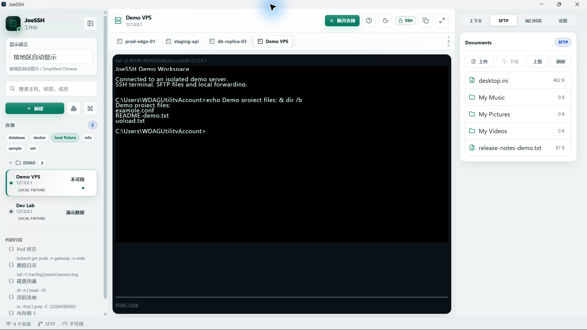

# JoeSSH

[English](README.md) · **简体中文**

**免费开源的 Windows SSH 和 SFTP 工作区。**

在一个窗口中连接 VPS 或开发测试服务器，切换终端会话、传输文件和管理本地端口转发。无需注册 JoeSSH 账号；连接配置和偏好默认保存在本机。

**[从 Microsoft Store 免费安装 JoeSSH](https://apps.microsoft.com/detail/9nk5llmf8lhm)**

Windows 10/11 x64 · 公开测试版 · MIT 开源许可

图中当前会话连接到隔离演示环境中的本机回环 SSH 服务器；其他连接、标签和文件为演示数据。

## 功能

- **SSH 终端：**使用密码或粘贴私钥连接服务器，在工作区切换多个会话。
- **SFTP 文件管理：**浏览目录、上传和下载文件；公开测试版每次上传或下载上限为 **25 MiB**。
- **本地端口转发：**按需启动和停止显式转发，监听地址仅限本机回环。
- **本地工作区：**保存连接配置、分组和标签，并选择浅色或深色主题。

首次连接未知主机时，请通过可信渠道核对服务器的 SHA-256 主机密钥指纹，再决定是否信任；已保存的主机密钥发生变化时，JoeSSH 会阻止连接。遥测和错误报告默认关闭。

## 开始使用

你需要一台有权访问且网络可达的 SSH 服务器，以及地址、端口、用户名、密码或私钥。JoeSSH 是客户端，不提供或托管服务器。

1. 从 [Microsoft Store](https://apps.microsoft.com/detail/9nk5llmf8lhm) 安装并打开 JoeSSH。
2. 选择“新建”，填写服务器地址、端口和用户名并创建连接，再输入服务器密码或私钥。
3. 首次连接时，从服务器控制台或管理员等可信渠道核对主机密钥指纹；确认一致后连接，即可使用终端、SFTP 和本地端口转发。

如果已保存的主机密钥发生变化，请先核实服务器或密钥轮换情况，不要仅为绕过警告而清除信任记录。[完整上手和故障排查指南（英文）](docs/getting-started.md)提供更多说明。

## 范围与支持

JoeSSH 目前处于公开测试阶段，操作重要文件前请保留备份。Windows 商店版和仓库最新源码的版本可能不同；GitHub 预发布版本是源码预览，不包含 Windows 安装程序。

仓库还包含可自行部署的同步服务、只读 Web Admin 和预览版移动端。同步服务目前不提供端到端载荷加密，不应同步密码、私钥或令牌；具体边界和开发说明见 [英文主页](README.md)。

- [使用指南（英文）](docs/getting-started.md)
- [反馈问题](https://github.com/JoeWorkspace/JoeSSH/issues/new/choose)（请移除凭据、私钥和敏感输出）
- [隐私说明](PRIVACY.md) · [安全报告](SECURITY.md) · [贡献指南](CONTRIBUTING.md)
